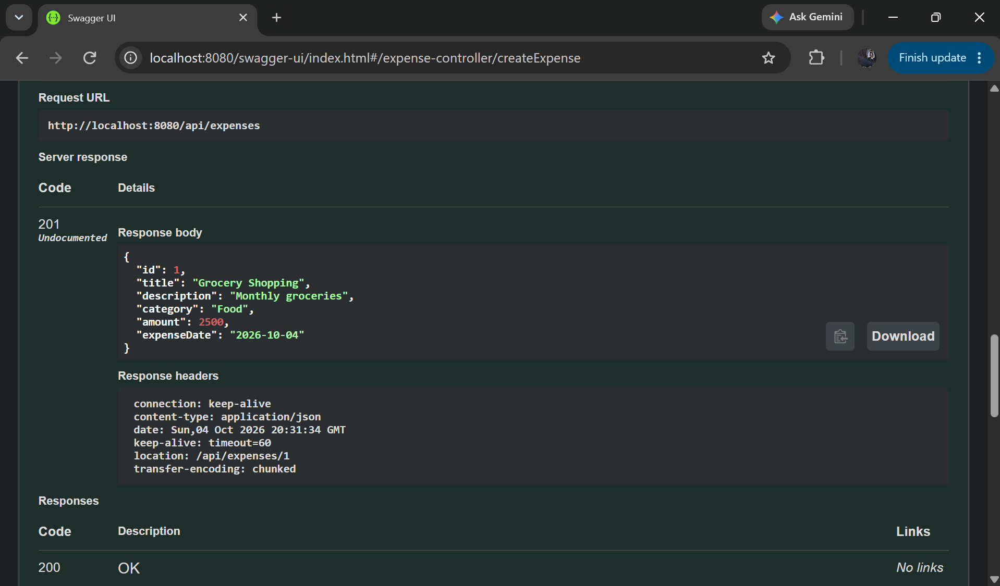
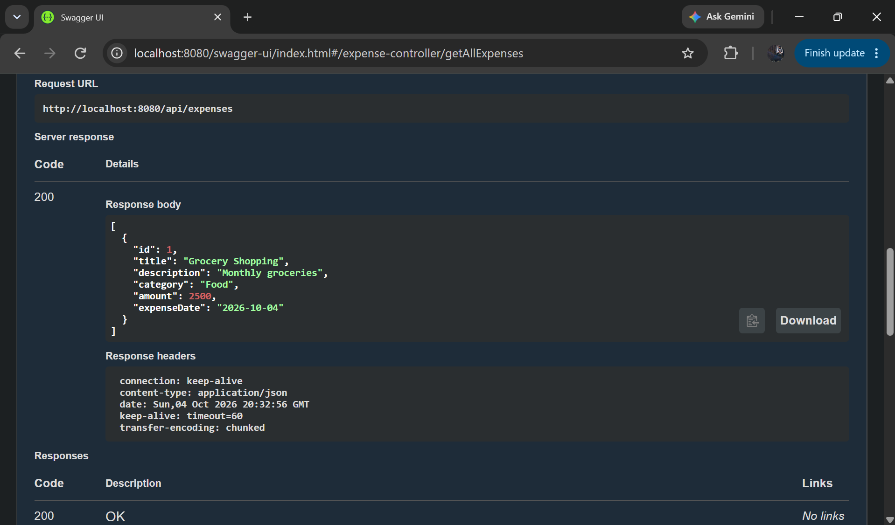
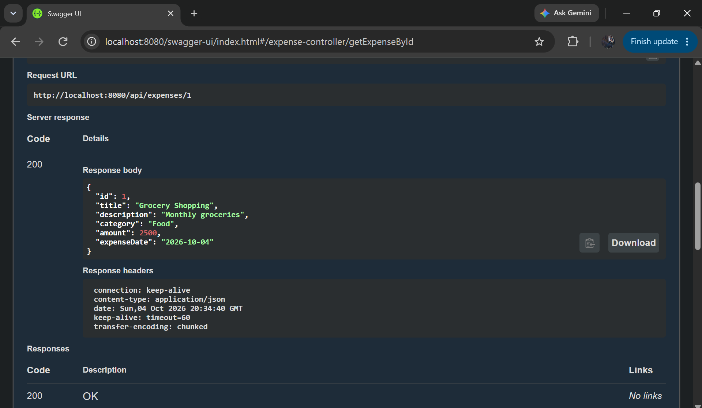
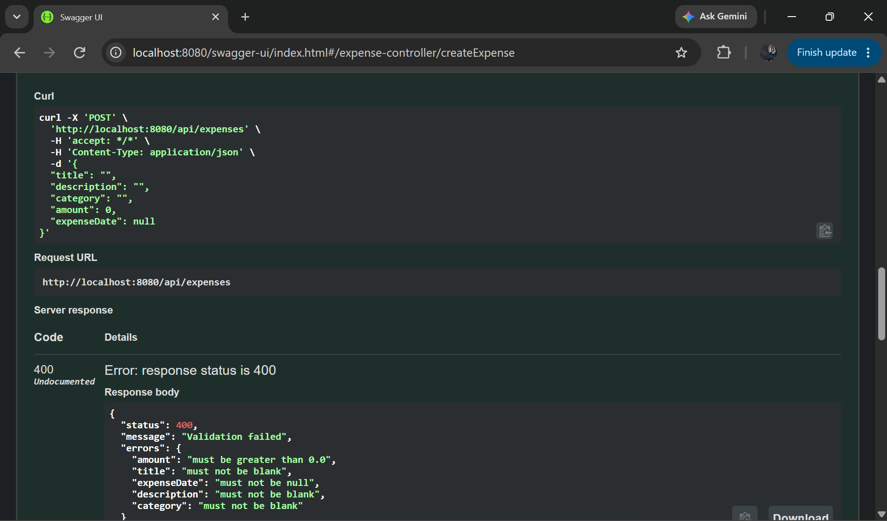
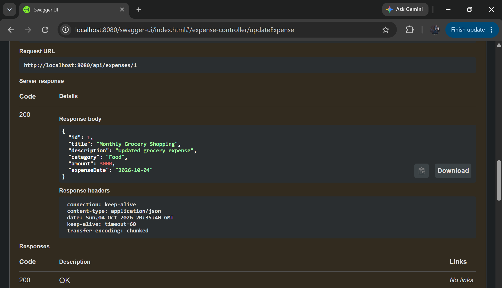
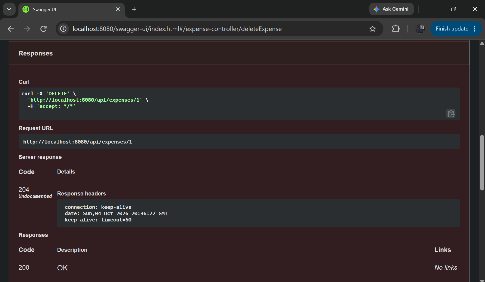

# Expense Management REST API

A Spring Boot REST API for recording and retrieving expenses. It supports CRUD operations, category and amount searches, and pageable, sortable results. Expense data is stored in MySQL.

## Use Case

Use the API to keep a central record of expenses, including their title, description, category, amount, and date. Clients can create or update expenses, retrieve records, filter by category or amount, and page through larger result sets.

## Expense Fields

| Field | Type | Description |
| --- | --- | --- |
| `id` | `Long` | Database-generated identifier |
| `title` | `String` | Expense title |
| `description` | `String` | Expense description |
| `category` | `String` | Expense category |
| `amount` | `BigDecimal` | Monetary amount |
| `expenseDate` | `LocalDate` | Date of the expense, formatted as `YYYY-MM-DD` |

## Architecture

The application follows a Controller -> Service -> Repository -> Database flow:

```text
expense/controller  HTTP endpoints and request validation
expense/service     Expense operations and DTO/entity mapping
expense/repository  Spring Data JPA persistence and queries
expense/entity      JPA Expense entity
expense/dto         ExpenseRequest and ExpenseResponse API models
exception           Shared not-found exception and REST error handling
```

Controllers use DTOs rather than exposing JPA entities. Business operations and persistence coordination are handled by the service layer.

## Technologies

- Java 17
- Spring Boot 4.1.1
- Gradle Wrapper 9.7.1
- Spring Web MVC
- Spring Data JPA and Hibernate
- MySQL Connector/J
- Jakarta Bean Validation
- Springdoc OpenAPI 3.1.0
- Docker with a multi-stage build

## API Endpoints

The base URL is `http://localhost:8080`.

| Method | Endpoint | Description | Success status |
| --- | --- | --- | --- |
| `POST` | `/api/expenses` | Create an expense | `201 Created` |
| `GET` | `/api/expenses` | Retrieve all expenses | `200 OK` |
| `GET` | `/api/expenses/{id}` | Retrieve an expense by ID | `200 OK` |
| `PUT` | `/api/expenses/{id}` | Replace an expense | `200 OK` |
| `DELETE` | `/api/expenses/{id}` | Delete an expense | `204 No Content` |
| `GET` | `/api/expenses/category/{category}` | Search by category, ignoring case | `200 OK` |
| `GET` | `/api/expenses/minimum-amount?minimumAmount={amount}` | Find expenses strictly greater than the amount | `200 OK` |
| `GET` | `/api/expenses/amount-range?minimumAmount={min}&maximumAmount={max}` | Find expenses within the inclusive amount range | `200 OK` |
| `GET` | `/api/expenses/page?page={page}&size={size}&sort={property},{direction}` | Retrieve a page of expenses with optional sorting | `200 OK` |

Page numbers are zero-based. Spring Data's pageable parameters support sorting; for example, `?page=0&size=10&sort=expenseDate,desc` returns the first ten records, newest expense date first.

## Request and Response Examples

Create and update requests use this JSON body:

```json
{
  "title": "Office supplies",
  "description": "Notebooks and pens",
  "category": "Office",
  "amount": 24.95,
  "expenseDate": "2026-10-05"
}
```

A successful create or retrieval returns an `ExpenseResponse`:

```json
{
  "id": 1,
  "title": "Office supplies",
  "description": "Notebooks and pens",
  "category": "Office",
  "amount": 24.95,
  "expenseDate": "2026-10-05"
}
```

Validation failures return HTTP `400` using this response shape:

```json
{
  "status": 400,
  "message": "Validation failed",
  "errors": {
    "title": "must not be blank"
  }
}
```

Missing expenses return HTTP `404`. Unexpected server errors return HTTP `500` with a generic message.

## Validation

The create and update request body is validated with Jakarta Bean Validation:

- `title`, `description`, and `category` must not be blank.
- `amount` is required and must be greater than zero.
- `expenseDate` is required and must use the ISO date format `YYYY-MM-DD`.

## MySQL Configuration

Create the database before starting the application:

```sql
CREATE DATABASE expense_management;
```

The default JDBC URL is `jdbc:mysql://localhost:3306/expense_management`. Set the username and password in the environment; do not put credentials in source control.

PowerShell:

```powershell
$env:DB_USERNAME = "<your MySQL username>"
$env:DB_PASSWORD = "<your MySQL password>"
```

Bash or WSL:

```bash
export DB_USERNAME="<your MySQL username>"
read -rsp "MySQL password: " DB_PASSWORD; echo
export DB_PASSWORD
```

Use the actual username and password values, not the literal strings `${DB_USERNAME}` or `${DB_PASSWORD}`. The configured Hibernate schema mode is `update`, and SQL logging is enabled. These settings are suitable for local development; use profile-specific settings and a controlled migration strategy in production.

## Run with Gradle

Install Java 17 or later and make sure MySQL is running with the database and credentials configured above. From the project root:

Windows PowerShell:

```powershell
.\gradlew.bat bootRun
```

Bash or WSL:

```bash
./gradlew bootRun
```

Run the test suite with `./gradlew test` (or `.\gradlew.bat test` on Windows). The current Spring Boot context test also needs a reachable MySQL database and valid environment variables.

## Swagger and OpenAPI

- Swagger UI: [http://localhost:8080/swagger-ui.html](http://localhost:8080/swagger-ui.html)
- OpenAPI JSON: [http://localhost:8080/v3/api-docs](http://localhost:8080/v3/api-docs)

## Docker

The root `Dockerfile` uses Gradle and a Java 17 JDK to build the Spring Boot JAR, then copies it into a Java 17 JRE image. The runtime runs as a non-root user. Database credentials are not included in the image.

Build the image from the project root:

```bash
docker build -t expense-management-api .
```

When the database runs on the Docker host, the application container cannot use `localhost` to reach it. Override the JDBC URL with an address reachable from the container. For Docker Desktop, `host.docker.internal` commonly addresses the host:

```bash
docker run --rm -p 8080:8080 \
  -e DB_USERNAME="$DB_USERNAME" \
  -e DB_PASSWORD="$DB_PASSWORD" \
  -e SPRING_DATASOURCE_URL="jdbc:mysql://host.docker.internal:3306/expense_management" \
  expense-management-api
```

If MySQL runs in another container, put both containers on the same Docker network and use the MySQL container or Compose service name in `SPRING_DATASOURCE_URL`.

## cURL Examples

Create an expense:

```bash
curl -i -X POST http://localhost:8080/api/expenses \
  -H 'Content-Type: application/json' \
  -d '{"title":"Office supplies","description":"Notebooks and pens","category":"Office","amount":24.95,"expenseDate":"2026-10-05"}'
```

Get all expenses or one expense:

```bash
curl http://localhost:8080/api/expenses
curl http://localhost:8080/api/expenses/1
```

Update and delete an expense:

```bash
curl -i -X PUT http://localhost:8080/api/expenses/1 \
  -H 'Content-Type: application/json' \
  -d '{"title":"Office supplies","description":"Paper and pens","category":"Office","amount":29.50,"expenseDate":"2026-10-05"}'

curl -i -X DELETE http://localhost:8080/api/expenses/1
```

Search and paginate:

```bash
curl 'http://localhost:8080/api/expenses/category/office'
curl 'http://localhost:8080/api/expenses/minimum-amount?minimumAmount=20.00'
curl 'http://localhost:8080/api/expenses/amount-range?minimumAmount=10.00&maximumAmount=50.00'
curl 'http://localhost:8080/api/expenses/page?page=0&size=10&sort=expenseDate,desc'
```

## Screenshots

### Swagger UI: Create Expense



### Get All Expenses



### Get Expense by ID



### Validation Error



### Update Expense



### Delete Expense

